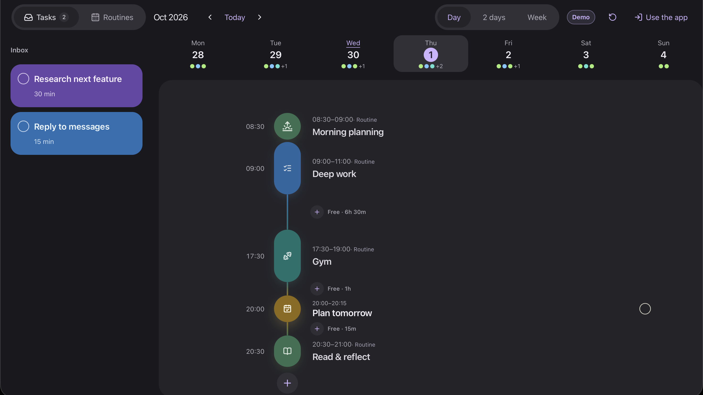
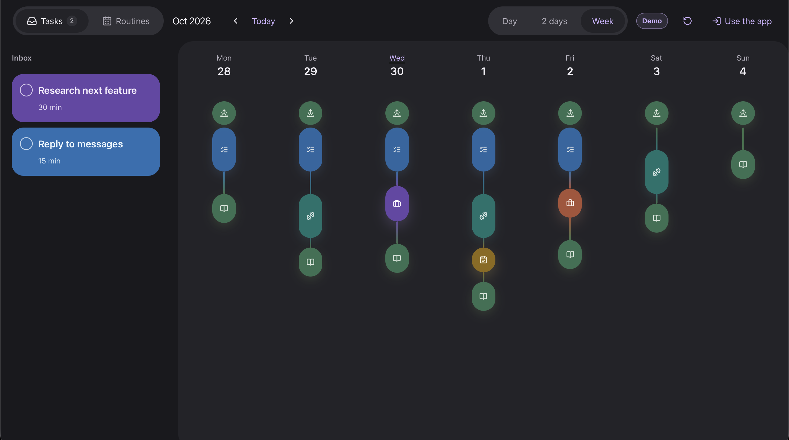
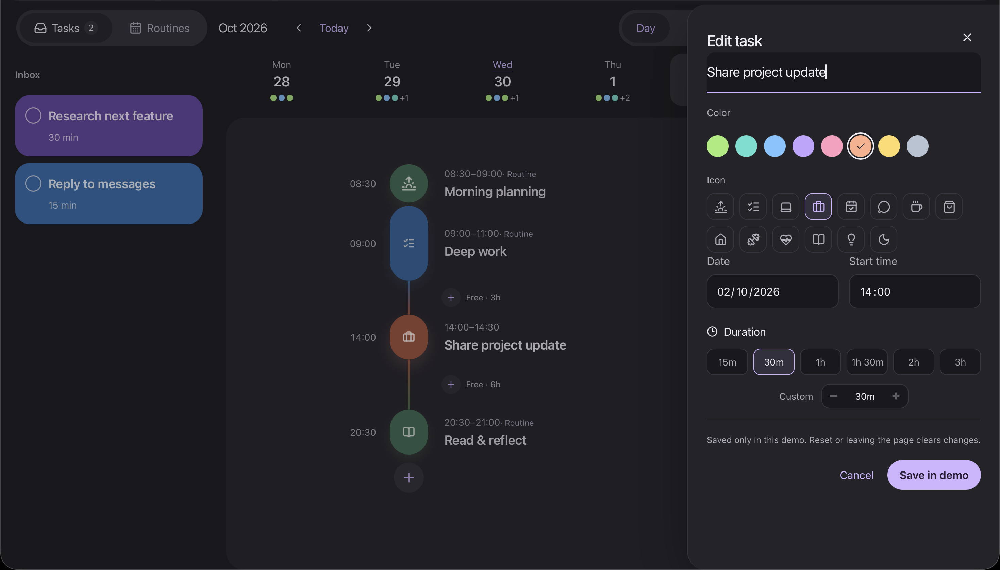

# DayFlow — Plan tomorrow tonight

DayFlow is a personal daily planner for making a calm plan tonight and following it tomorrow. It combines an Inbox, a visual timetable, recurring weekly routines, and fast Day / 2 days / Week views.

**Version:** 2.0.0 · [What’s new](CHANGELOG.md)

**Live app:** [dayflow.htetkooo.dev](https://dayflow.htetkooo.dev)
**Explore the demo:** [dayflow.htetkooo.dev/demo](https://dayflow.htetkooo.dev/demo)



## Live demo

Open [/demo](https://dayflow.htetkooo.dev/demo) to explore a complete sample plan without creating an account. Demo tasks and routines are generated around the viewer’s current date, and every change resets when the visitor leaves the page. Create an account to save personal data.

## Highlights

### Plan the whole week



### Edit tasks without losing your place



## What DayFlow does

- Email/password and Google authentication, email confirmation, password reset, and account settings
- Inbox tasks with title, notes, color, icon, duration, completion, and deletion
- Schedule tasks in the timetable, edit them, or return them to Inbox
- Drag tasks between Inbox and timetable; drag scheduled tasks to a new time
- Immediate UI updates with background server confirmation, Undo, and realtime task/routine sync across tabs and devices
- Day, 2 days, and Week views with URL-based navigation
- Weekly routines with chosen weekdays, start date, optional end date, start time, duration, and notes
- Edit, skip, reschedule, and restore one routine occurrence without changing the weekly rule
- Calendar `.ics` export/import with timezone conversion, private imports by default, and duplicate detection
- View-only timetable links with private tasks and routines excluded; manage links in Settings
- Display name, timezone, notification, appearance, and sharing settings
- Browser reminders and device-specific Web Push reminders through a scheduled Supabase Edge Function
- Save buttons detect actual changes and validate drafts before submission
- Responsive desktop and mobile UI, dark/light/system appearance, and PWA install support
- Always-visible tomorrow planning shortcut with a quiet evening reminder
- Permanent account deletion with a session-bound email code and typed confirmation safeguards
- In-app feedback and bug reports, optional reply email, and developer email notifications
- Public privacy policy at `/privacy`, linked from Login and Settings → App

## Stack

- Next.js App Router, React, TypeScript
- Supabase Auth, PostgreSQL, Row Level Security, and Realtime
- Resend SMTP for transactional authentication email and Google OAuth
- dnd-kit, date-fns, Zod, Radix UI, Lucide
- Vercel deployment and pnpm

## Local setup

**Requirements:** Node.js 24, pnpm 10, and a Supabase project.

```sh
pnpm install --frozen-lockfile
cp .env.example .env.local
pnpm dev
```

Open [http://localhost:3000](http://localhost:3000). Restart the development server after changing `.env.local`.

### Environment variables

```env
NEXT_PUBLIC_SUPABASE_URL=
NEXT_PUBLIC_SUPABASE_PUBLISHABLE_KEY=
# Optional: enables the Web Push subscription UI
NEXT_PUBLIC_VAPID_PUBLIC_KEY=
# Server only: feedback email notifications
RESEND_API_KEY=
FEEDBACK_FROM_EMAIL="DayFlow <feedback@your-verified-domain.com>"
FEEDBACK_TO_EMAIL=
# Server only, Sensitive in Vercel: registers account-deletion OTP challenges
SUPABASE_SECRET_KEY=
```

The `NEXT_PUBLIC_SUPABASE_*` values are browser-safe and identify the Supabase project. The VAPID public key is also browser-safe. Keep `RESEND_API_KEY`, `FEEDBACK_FROM_EMAIL`, and `FEEDBACK_TO_EMAIL` on the server; never give them a `NEXT_PUBLIC_` prefix. The optional `SUPABASE_SECRET_KEY` is a privileged server-only key used to register account-deletion verification challenges. Mark it Sensitive in Vercel and never expose it to the browser. Do not put database passwords or Supabase access tokens in the app environment. RLS protects each user’s rows.

## Database and Supabase

Link the CLI once, then use migration files as the database source of truth:

```sh
pnpm exec supabase login
pnpm exec supabase link --project-ref YOUR_PROJECT_REF
pnpm exec supabase db push
```

### Push reminders

Push requires separate configuration: generating a matching VAPID key pair, setting Edge Function secrets, deploying `send-reminders`, and scheduling it every minute. Deploying the website alone does not schedule notifications. Follow [Push setup and troubleshooting](docs/PUSH-REMINDERS.md).

### Feedback email

Apply the feedback migration with the other migrations. Set `RESEND_API_KEY` (Sensitive in Vercel), `FEEDBACK_FROM_EMAIL` (Config), and `FEEDBACK_TO_EMAIL` (Config). The sender domain must match the domain allowed by the key. In Vercel, enter values without surrounding quotes and redeploy after changes. The local dev server must be restarted after environment changes.

Feedback is saved before email delivery; a missing or failed email does not discard the report. Check `public.feedback` in Supabase and the server logs if notification email is missing. Users cannot read feedback records. See [feedback behavior and setup](docs/V2-GUIDE.md#feedback-and-issue-reports).

### Account deletion verification

Apply `20261027000200_account_deletion.sql` and `20261027000300_account_deletion_otp.sql` before deploying. Set `SUPABASE_SECRET_KEY` to a Supabase secret API key (`sb_secret_…`) in `.env.local` and Vercel (Sensitive); reuse the verified `FEEDBACK_FROM_EMAIL` and `RESEND_API_KEY` for OTP email. Keep the key server-only and never use `NEXT_PUBLIC_`. See [Supabase key guidance](https://supabase.com/docs/guides/getting-started/api-keys). A code goes only to the authenticated account’s verified email, expires in 10 minutes, allows five failed attempts, and is bound to that browser session and the deletion purpose. Codes can be requested once per minute, up to five times per hour per account. No real deletion should be tested without an explicitly disposable account.

### Authentication configuration

For the deployed application, configure Supabase Auth with the following URLs:

- **Site URL:** `https://dayflow.htetkooo.dev`
- **Redirect URLs:** `https://dayflow.htetkooo.dev/**` and `http://localhost:3000/**`

The confirmation-email template must use `ConfirmationURL`, so local and production links both return to the correct callback route:

```html
<a href="{{ .ConfirmationURL }}"> Confirm your email </a>
```

Configure a custom SMTP provider before inviting real users. DayFlow uses Resend with a verified sending subdomain and a sender such as `DayFlow <no-reply@mail.htetkooo.dev>`. Store the authentication SMTP credentials in Supabase **Authentication → SMTP Settings**. Feedback uses a separate server-only `RESEND_API_KEY` in `.env.local` and Vercel. Prefer a dedicated sending-only key restricted to the feedback sender’s verified domain. Never expose either key to browser code.

To enable Google sign-in:

1. Create a Web OAuth client in Google Cloud.
2. Add `https://dayflow.htetkooo.dev` and `http://localhost:3000` as authorized JavaScript origins.
3. Copy the Supabase Google provider callback URL (`https://YOUR_PROJECT_REF.supabase.co/auth/v1/callback`) into Google Cloud's authorized redirect URIs.
4. Enable Google in Supabase **Authentication → Providers**, then add the Google Client ID and Client Secret there.

Google OAuth secrets belong in Supabase’s Google provider settings. Authentication SMTP credentials and the application’s feedback email key are configured separately as described above.

For local Supabase development (Docker required):

```sh
pnpm db:start
pnpm db:reset
pnpm db:types
pnpm db:stop
```

`pnpm db:reset` only resets the local database. Never use it for production data.

## Quality checks

```sh
pnpm lint
pnpm typecheck
pnpm test
pnpm test:db
pnpm build
```

`pnpm check` runs the lint, type, unit, and database checks together. `pnpm build` is the final production-build verification.

## Deploying to Vercel

1. Push the repository to GitHub. A private repository works.
2. Import the repository into Vercel with the Next.js preset.
3. Set Node.js 24, `pnpm install --frozen-lockfile` as the install command, and `pnpm build` as the build command.
4. Add `NEXT_PUBLIC_SUPABASE_URL` and `NEXT_PUBLIC_SUPABASE_PUBLISHABLE_KEY` for Production and Preview as appropriate. Add `NEXT_PUBLIC_VAPID_PUBLIC_KEY` to environments using push, then rebuild/redeploy after changing it. Add the three server-only feedback settings described above.
5. Apply pending Supabase migrations with `pnpm exec supabase db push`.
6. Connect `dayflow.htetkooo.dev` in Vercel and configure its DNS records with the domain provider.
7. Update Supabase Auth Site URL and Redirect URLs, configure Resend SMTP, and enable Google OAuth.
8. Smoke-test email signup/confirmation, password reset, Google sign-in, planner navigation, drag/drop, routines, and task/routine edits in a second browser or device before release.

## Project map

```text
src/app/                     Routes and authenticated server actions
src/components/auth/         Login, signup, confirmation, and password recovery
src/components/planner/      Planner UI, editor components, and planner hooks
src/lib/tasks/               Schedule, routines, colors, and agenda utilities
src/lib/supabase/            Browser and server Supabase clients
src/lib/validation/          Zod schemas for server actions
supabase/migrations/         Versioned schema, policies, realtime, and planner data
scripts/test-rls.mjs         Database/RLS isolation checks
tests/                       Unit tests
public/                      PWA icons and offline fallback
src/app/manifest.ts          PWA manifest
src/app/sw.js/route.ts       Versioned service worker endpoint
```

## Documentation

- [V2 usage and current limitations](docs/V2-GUIDE.md)
- [Push reminder setup and troubleshooting](docs/PUSH-REMINDERS.md)
- [PWA implementation, build, and testing](docs/PWA.md)
- [Architecture and operations](docs/ARCHITECTURE.md)
- [V2 release checklist and validation evidence](docs/V2-RELEASE.md)
- [Changelog](CHANGELOG.md)
- [V2.0.0 release notes](docs/RELEASE-2.0.0.md)
- [Original V1 product scope](docs/V1-BLUEPRINT.md) — historical planning reference; the implementation now includes V2 features.
